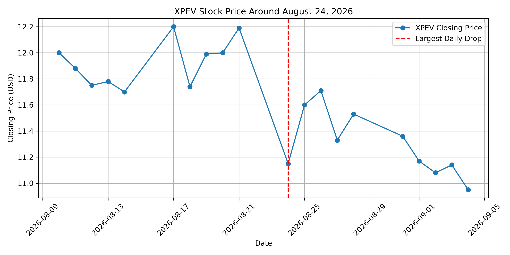

# ev-stock-analysis

Group project analyzing the price behavior of three EV makers (BYDDY, TSLA, XPEV) over Apr 15 – Oct 15, 2026, using yfinance and pandas.

## Group Members
- Member 1: Jiayue Deng
- Member 2: ______
- Member 3: ______

## Tickers and Date Range
1. BYDDY — BYD Company Ltd (ADR) — Jiayue Deng
2. XPEV — XPeng Inc. (ADR)
3. TSLA — Tesla, Inc.
- Date range: **2026-04-15 ~ 2026-10-15** (same for all tickers)

## Why These 3 Tickers
The three are direct competitors in the EV space, so comparing them shows how companies in the same industry responded differently to shared events like China EV demand, export policy, macro conditions, and so on.

## Setup
This project requires yfinance for stock data, pandas for data processing, and matplotlib for visualization.
Install dependencies:
```bash
pip install yfinance pandas matplotlib
```
Run:
```bash
python analysis.py       # 3-ticker loading, stats, correlation, 4 charts
python analysis_BYDDY.py # BYDDY monthly summary, movements & business story
```
Charts are saved to `charts/`.

## Business Question
This analysis answers questions we can address directly from the data:

1. **Why did the three EV stocks move so differently over the same period?**
2. **How did BYDDY's price trend overall?** It fell about 33%, from a period high of 14.28 on 2026-04-16 to a low of 9.22 on 2026-10-14.
3. **How volatile was BYDDY, and what did its daily returns look like?** Daily-return std was about 2.03% with a mean of about −0.30%; the largest one-day gain was +5.50% (2026-07-01) and the largest drop was −3.67% (2026-08-31).
4. **Which dates had the biggest moves, and what business events were associated with them?** Apr-16 oil-driven high, Jul-01 sales-recovery gain, Aug-31 earnings-miss drop, and Oct-14 policy-headwind low.
5. **Did volume support those moves?** The Aug-31 drop came on below-average volume (~0.90x, a valuation adjustment), while the Oct-14 low came on above-average volume (~1.22x, policy-driven selling).
6. **How did BYDDY's monthly performance evolve?** Monthly average closing price fell from ~13.57 in April to ~9.42 in October.

## Summary of Findings
### BYDDY business story
- On Apr 16 BYD hit its highest price because high oil prices from the Iran war boosted BYD's overseas sales, and its higher export target and new technology lifted the stock to its peak. Oil prices then plunged on Apr 17 and Q1 profit fell sharply, so the stock never returned to that level.
- BYD's stock fell all year as car sales in China kept shrinking. Just days before Oct 14, the EU capped Chinese hybrid imports and China cut its export tax rebate, hitting exports — BYD's main growth engine. Even record export numbers could not lift the stock, because investors worried BYD would earn less from its overseas sales.
- On Jul 1 BYD reported a second straight month of sales growth and record overseas sales, easing fears that its sales slump would continue. Coming right after the stock had fallen to a two-year low, the good news triggered a strong rebound.
- But reality fell short: Q2 profit, reported on Aug 28, rose about 30% yet came in about 12% below expectations, and first-half profit fell 20.5%. On the first trading day after the results (Aug 31), the stock posted its biggest one-day drop of the year.

> Note: the full source URLs for each BYDDY movement are provided in `analysis_BYDDY.py` (see the "Explanations & Supporting Sources" section of its output). Key sources: PBS, Bloomberg, Electrek, USNews, CNBC, Morningstar, CnEVPost, AutomotiveWorld, Business Outreach, OpenBell.

## Data-Backed Findings
1. BYDDY fell about 33% (14.28 → 9.22) while TSLA was relatively flat.
2. Volume pattern: the Aug-31 drop was on below-average volume (~0.90x, adjustment), while the Oct-14 low was on above-average volume (~1.22x, policy-driven selling).
3. Volatility: TSLA daily-return std ≈ 3.03% vs BYDDY ≈ 2.03% — TSLA was the most volatile.
4. BYDDY and XPEV daily returns correlate at ~0.50 (they co-move), vs ~0.14 with TSLA.

## Visualizations
Charts are saved in `charts/`.

- **Chart 1 — Normalized closing prices (Apr 15 – Oct 15, start = 100):** BYDDY and XPEV trended down over the period while TSLA held up better, showing the three EV makers diverged despite operating in the same industry.
- **Chart 2 — BYDDY close, Aug–Oct 2026 (zoom on the significant-movement):** BYDDY fell steadily and hit its period low of 9.22 on Oct 14, right after the EU hybrid-import cap and China's export-rebate cut.
- **Chart 3 — Distribution of daily returns (boxplot):** TSLA had the widest daily swings (std ≈ 3.03%) and BYDDY the smallest, so TSLA was the most volatile of the three.
- **Chart 4 — BYDDY vs XPEV daily returns (scatter):** the two stocks' daily returns are positively correlated (r ≈ 0.50), consistent with the two Chinese EV makers moving together.

## Limitations
The data show historical price and volume patterns consistent with the cited news, but attributing any single day's move to one event is inference, not proof. Other factors may have contributed; correlation does not imply causation. This describes historical patterns only — not predictions or financial advice.


## XPEV Stock Analysis

### Significant Price Movements

Our analysis examines XPeng (NYSE: XPEV) from April 15 to October 15, 2026.

**Largest Daily Increase — May 26, 2026**

XPEV recorded its largest daily increase of **6.16%**, closing at **$16.55**. Trading volume reached **11,675,400 shares**, approximately **1.63 times** the average daily trading volume.

**Largest Daily Decrease — August 24, 2026**

XPEV recorded its largest daily decrease of **8.53%**, closing at **$11.15**. Trading volume reached **26,442,200 shares**, approximately **3.69 times** the average daily trading volume.

### Key Findings

1. XPEV's average daily return was approximately **-0.44%** during the analysis period.
2. The standard deviation of daily returns was approximately **2.68%**, indicating noticeable day-to-day fluctuations.
3. The largest daily decline was accompanied by trading volume substantially above the period average, suggesting unusually high trading activity.

### Visualization



*Figure: XPEV closing prices around August 24, 2026. The red dashed line marks the date of the largest daily decline.*

### Limitations

Stock price changes may reflect company announcements, industry competition, investor expectations, and broader market conditions. Trading volume and price movements alone do not establish causation. Further research into contemporary business news is required to explain the specific events.
